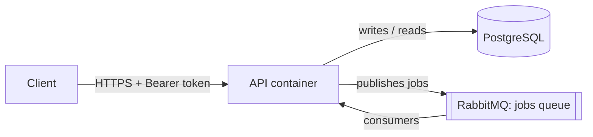

# Architecture Diagram

## Services

| Service | Role | Default port |
| --- | --- | --- |
| API | Receives requests, writes to the database, publishes jobs to the queue | set in the container config |
| PostgreSQL | Stores application data | 5432 |
| RabbitMQ | Holds the `jobs` queue | 5672 |

## Startup order

PostgreSQL, then RabbitMQ, then the API.
